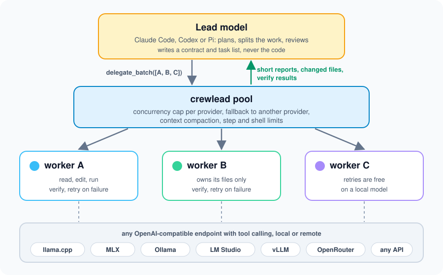
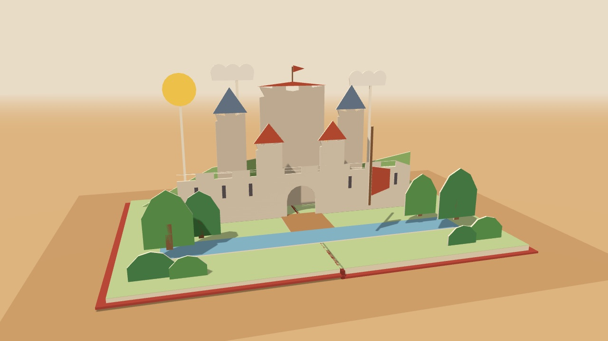
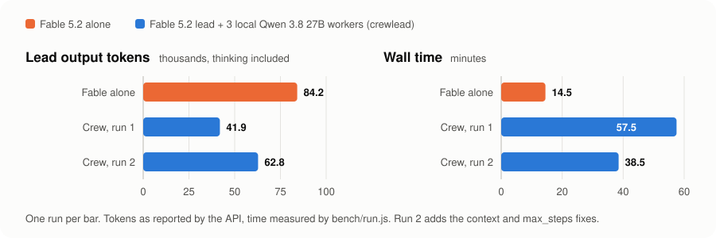

<p align="center">
  
</p>

<h1 align="center">Crewlead MCP</h1>

<p align="center">
  <strong>One lead model plans and reviews. Cheap workers write the code in parallel.</strong><br>
  For Claude Code, Codex and Pi. Workers run on your Mac, your GPU box or any OpenAI-compatible API.
</p>

<p align="center">
  <a href="LICENSE"></a>
  
  
  
</p>

<p align="center">
  <a href="#quick-start-with-claude-code">Quick start</a> &middot;
  <a href="#example-a-pop-up-book-film">Example</a> &middot;
  <a href="#example-prompts">Prompts</a> &middot;
  <a href="#best-setup-on-a-mac">Mac setup</a> &middot;
  <a href="#setup-recipes">Setup recipes</a> &middot;
  <a href="#tools-the-lead-gets">Tools</a> &middot;
  <a href="#configuration">Configuration</a> &middot;
  <a href="docs/testing.md">Test report</a>
</p>

A crew lead reads the plans and gives the orders, and the crew does the building. Crewlead does the same with LLMs. Your expensive model stays in your coding agent as the lead. Light worker models, local or remote, do the typing and the retries.

<p align="center">
  
</p>

## Why

The lead model is the expensive part of an agent run. Most of its output tokens go into typing code it has already designed. Crewlead moves that typing to a worker:

- The lead writes a contract and a task list, then reads short reports. It never streams file contents.
- Each worker runs its own agent loop and only returns a summary, the changed files and a test result.
- A failed check is fed back to the worker, which retries on its own. On a local model those retries cost nothing.

## Example: a pop-up book film

The same prompt ([`bench/popup-book`](bench/popup-book/prompt.md)) built in Claude Code with Fable 5.2 as the lead. Left: Fable writes every file. Right: Fable plans and reviews in boss mode, and three Qwen 3.8 27B workers on a local llama.cpp server write every file.

| Fable alone | Fable + 3 local Qwen workers |
| --- | --- |
|  |  |
|  |  |
|  |  |
|  |  |
|  |  |

<p align="center">
  
</p>

With workers the lead wrote no file and produced fewer output tokens, but the whole run took longer. One run each, so data points and not a benchmark. Token counts are as the API reports them; there are no dollar figures because these runs were not billed per run. Rounds, worker results and the bugs these runs found: [docs/testing.md](docs/testing.md#6-pop-up-book-film-lead-alone-vs-lead-plus-workers).

## Quick start with Claude Code

**1. Start a worker model.** Any OpenAI-compatible server with tool calling works. On a Mac with llama.cpp:

```
brew install llama.cpp
llama-server -hf unsloth/Qwen3.8-27B-GGUF:UD-Q4_K_XL --jinja -c 196608 -np 3 --port 8080
```

The first start downloads the model (about 17 GB). Ollama, LM Studio and vLLM work too. For remote workers instead, or as a fallback, export `OPENROUTER_API_KEY` in the shell that starts Claude Code.

**2. Install the plugin.** In Claude Code:

```
/plugin marketplace add antonellof/crewlead
/plugin install crewlead@crewlead
```

**3. Ask Claude to set it up.** In your project:

```
> set up crewlead
```

The `setup` tool finds the local servers on their default ports (llama.cpp 8080, Ollama 11434, LM Studio 1234, vLLM 8000), reads the model and the number of parallel slots, checks which API key variables are set, writes `crewlead.config.json` and sends a tool-calling test to every worker. API keys are never written to the file.

Then ask for work as usual. The lead splits it, hands it to the workers with `delegate_batch`, and reviews what comes back.

**Boss mode (optional).** Run `npx -y github:antonellof/crewlead boss on` in the project, or set `CREWLEAD_BOSS=1`. From then on each prompt reminds the lead to delegate, and `Edit` and `Write` are blocked for it, so every change goes through a worker. `boss off` turns it off.

**Long batches.** If workers get cut off, start Claude Code with `MCP_TOOL_TIMEOUT=1800000`.

## Example prompts

Type these to the lead (Claude Code, Codex or Pi). The lead plans, the workers write.

Set up or inspect the workers:

```
set up crewlead
which crewlead workers do I have, and are they working?
```

Build something new in parallel:

```
Build a todo CLI in Node with no dependencies: storage in src/store.js, argument parsing
in src/args.js, commands in src/cli.js, a node:test file per module. Use crewlead workers,
one per module, and make npm test pass.
```

Add tests to an existing project:

```
Write node:test tests for every module in src/ that has none. One crewlead worker per
module, each verified by running its own test file.
```

Refactor:

```
Split src/server.js into src/routes/, src/middleware/ and src/db/. Write the interface
contract first, then delegate one directory per worker with a node --check verify.
Run the full test suite at the end.
```

Fix a failing test:

```
test/parser.test.js fails. Find the cause, then have a worker fix it, verified with npm test.
```

Something bigger, the prompt used in [`bench/popup-book`](bench/popup-book/prompt.md):

```
Build a 30-second film in Three.js: a paper book opens and four pop-up worlds fold out of
it, a castle, a jungle, a port with boats and snowy peaks. Plain ES modules, no build step.
```

Choose where the work runs:

```
Use the builder-remote worker for this batch, the local server is busy.
```

Tips:

- **One file per task.** Small tasks with a clear file and a verify command pass on the first try far more often than broad ones like "build the book and the paper system".
- **Name the files and the functions.** The worker knows nothing about your conversation. The lead writes this for you, but the more exact your prompt, the better its contract.
- **Ask for a verify command.** `node --test test/x.test.js`, `node --check src/x.js`, a type check or a lint run. A failing check goes back to the worker, which retries for free on a local model.
- **Turn on boss mode** when you want to be sure the lead never writes code itself.

## Best setup on a Mac

Measured on a Mac Studio M5 Max with 128 GB, Qwen 3.8 27B with thinking off. Speed comes from [`bench/speed.js`](bench/speed.js) (400-token answers, end to end), and the batch is the same three real crewlead tasks (a CSV parser, an LRU cache, a slugify function, each with tests) on three workers. One run per row.

| Server | Weights | Memory in use | 1 stream | 3 streams combined | 3-task batch |
| --- | --- | --- | --- | --- | --- |
| llama.cpp 0.9.0 | [Qwen3.8-27B UD-Q4_K_XL](https://huggingface.co/unsloth/Qwen3.8-27B-GGUF) GGUF | 41.2 GB, with a 196K-token cache allocated | 26 tok/s | **54 tok/s** | 3 of 3, 99.8 s |
| mlx-vlm 0.7.12 | [Swift 1.5 Qwen3.8-27B MLX 8-bit](https://huggingface.co/robgaleano/Swift-1.5-Qwen3.8-27B-MLX-8bit) | 28.4 GB | 17 tok/s | 50 tok/s | 3 of 3, 94.3 s |
| mlx-vlm 0.7.12 + MTP drafter | same, plus the [MTP drafter](https://huggingface.co/robgaleano/Swift-1.5-Qwen3.8-27B-MTP-MLX-8bit) | not measured | **33 tok/s** | 37 tok/s | not run |

All three made 10 of 10 valid tool calls in the speed test.

**Which one:**

- **Three parallel workers, the normal crewlead case:** llama.cpp Q4 or MLX 8-bit without the drafter. They tied on the real batch. MLX keeps the weights at 8 bits; llama.cpp has the smaller download and the plain Apache 2.0 base model.
- **One worker at a time**, or a local model you also chat with: MLX 8-bit with the MTP drafter, the fastest single stream. In mlx-vlm 0.7.12 the drafter does not combine with parallel requests: three streams shared about the same 37 tok/s as one.
- **A Mac with 32 to 48 GB:** llama.cpp Q4 with `-np 2` and a smaller `-c`.

**MLX setup, three workers:**

```
brew install uv
APC_ENABLED=1 uv run --python 3.12 --with mlx-vlm==0.7.12 -- python -m mlx_vlm.server \
  --model robgaleano/Swift-1.5-Qwen3.8-27B-MLX-8bit \
  --max-num-seqs 3 --prefill-step-size 4096 --max-tokens 32768 --host 127.0.0.1 --port 8080
```

The first start downloads about 28 GB. Then ask the lead to `set up crewlead`, or copy [`examples/configs/mac-mlx.json`](examples/configs/mac-mlx.json). `setup` recognises mlx-vlm but cannot read `--max-num-seqs`, so set `maxConcurrency` to the same number. For one fast worker instead, add `--draft-model robgaleano/Swift-1.5-Qwen3.8-27B-MTP-MLX-8bit --draft-block-size 4` and set `maxConcurrency` to 1.

The Swift 1.5 fine-tune is under the [Swift Open License v1.0](https://huggingface.co/robgaleano/Swift-1.5-Qwen3.8-27B-MLX-8bit/blob/main/LICENSE), not Apache: free up to US$1M in annual revenue, a separate license above that. Not tested here: contexts above 64K tokens, thinking on, and raising the GPU memory limit (`iogpu.wired_limit_mb`), which these sizes did not need on 128 GB. Details: [docs/testing.md](docs/testing.md#7-mac-servers-llamacpp-vs-mlx).

## Setup recipes

[docs/setup.md](docs/setup.md) has full setups for each host (Claude Code, Codex, Pi, command line) and each kind of worker, with ready-to-copy files in [`examples/configs/`](examples/configs/):

| File | Workers |
| --- | --- |
| [`local-llamacpp.json`](examples/configs/local-llamacpp.json) | llama.cpp on this machine, 3 parallel slots |
| [`local-ollama.json`](examples/configs/local-ollama.json) | Ollama |
| [`local-lmstudio.json`](examples/configs/local-lmstudio.json) | LM Studio |
| [`openrouter-only.json`](examples/configs/openrouter-only.json) | OpenRouter, no GPU: a default and a cheaper `fast` profile |
| [`local-with-openrouter-fallback.json`](examples/configs/local-with-openrouter-fallback.json) | Local first, OpenRouter when the server is down or busy |
| [`two-machines.json`](examples/configs/two-machines.json) | Two llama.cpp servers on your LAN |
| [`mac-mlx.json`](examples/configs/mac-mlx.json) | MLX on Apple Silicon (mlx-vlm), 3 parallel workers |
| [`any-openai-compatible.json`](examples/configs/any-openai-compatible.json) | Template for vLLM, hosted APIs or a company gateway |

## Other ways to install

### Claude Code, MCP server only

The tools without the skill and the boss mode hooks:

```
claude mcp add crewlead -- npx -y github:antonellof/crewlead mcp
```

Add `--scope user` for every project. `claude mcp list` should show `crewlead ... Connected`.

From a terminal, the plugin install is `claude plugin marketplace add antonellof/crewlead` then `claude plugin install crewlead@crewlead`. From a local clone, pass the path to `marketplace add`, or try it for one session with `claude --plugin-dir /path/to/crewlead`.

### Codex

In `~/.codex/config.toml`:

```toml
[mcp_servers.crewlead]
command = "npx"
args = ["-y", "github:antonellof/crewlead", "mcp"]
startup_timeout_sec = 30
tool_timeout_sec = 1800
env_vars = ["OPENROUTER_API_KEY"]   # forwards the key from your shell, never stores it
```

Paste [`codex/AGENTS.snippet.md`](codex/AGENTS.snippet.md) into your `AGENTS.md` so the lead knows how to delegate. Not yet tested in a real Codex session.

### Pi

```
pi install git:github.com/antonellof/crewlead
```

The extension registers the same tools natively, plus a `/workers` command. No MCP involved. Not yet tested in a real Pi session.

### Command line

```
npx -y github:antonellof/crewlead init      # find local servers, write crewlead.config.json
npx -y github:antonellof/crewlead doctor    # test every worker
npx -y github:antonellof/crewlead run "Create fizzbuzz.js and a node:test file for it" --verify "node --test"
```

`init --user` writes `~/.config/crewlead/config.json` for every project. `init --url http://host:port/v1` probes a server on another port.

## Tools the lead gets

**`delegate`** runs one task. **`delegate_batch`** runs many in parallel and waits for all. A task has these fields:

| Field | Meaning |
| --- | --- |
| `task` | Complete instructions. The worker knows nothing about the lead's conversation. |
| `context` | The interface contract. Give the same text to every parallel task. |
| `owns` | Paths the worker may write. Writes elsewhere are rejected. |
| `verify` | Command that must exit 0. On failure the worker gets the output and retries. |
| `worker` | Profile name. Omit for the default. |
| `cwd`, `id` | Working directory and a label |

A result looks like this:

```json
{
  "id": "parser",
  "status": "done",
  "report": "Built src/parser.js with parse(). 6 tests pass.",
  "filesChanged": ["src/parser.js", "test/parser.test.js"],
  "verify": { "command": "node --test test/parser.test.js", "passed": true, "attempts": 2 },
  "steps": 9,
  "worker": "builder",
  "provider": "local",
  "model": "qwen3.8-27b",
  "usage": { "promptTokens": 41250, "completionTokens": 3120, "costUsd": null },
  "seconds": 74.2
}
```

`status` is `done`, `verify_failed`, `max_steps` or `error`. Only `done` means the work was accepted.

**`list_workers`** shows the configured profiles. It never returns keys.

**`setup`** configures crewlead: `detect` finds servers and suggests a config, `write` writes it (project or user scope, never overwriting unless asked, never with inline keys), `check` tests every worker.

## Configuration

`setup` and `init` write this file for you. Edit it to add workers or change limits.

A worker is a provider (any OpenAI-compatible endpoint) plus a model. Mix local and remote freely:

```json
{
  "providers": {
    "local": { "baseUrl": "http://127.0.0.1:8080/v1", "maxConcurrency": 3 },
    "openrouter": { "baseUrl": "https://openrouter.ai/api/v1", "apiKeyEnv": "OPENROUTER_API_KEY", "maxConcurrency": 8 }
  },
  "workers": {
    "builder": { "provider": "local", "model": "qwen3.8-27b", "fallback": "builder-remote" },
    "builder-remote": { "provider": "openrouter", "model": "qwen/qwen3.8-27b" }
  },
  "defaultWorker": "builder"
}
```

Tasks go to the local server, three at a time. If it is down, each task moves to OpenRouter. The lead can also pick a profile per task with `"worker": "builder-remote"`.

Lookup order: `$CREWLEAD_CONFIG`, `./crewlead.config.json`, `./.crewlead/config.json`, `~/.config/crewlead/config.json`. With no file, crewlead uses Ollama at `127.0.0.1:11434` with `qwen3.8:27b`, or one endpoint from `CREWLEAD_BASE_URL`, `CREWLEAD_MODEL`, `CREWLEAD_API_KEY` and `CREWLEAD_MAX_CONCURRENCY`.

### Provider options

| Field | Meaning |
| --- | --- |
| `baseUrl` | OpenAI-compatible base URL, ending in `/v1` |
| `apiKeyEnv` | Name of the environment variable holding the key. Keep keys out of the file. |
| `maxConcurrency` | Max parallel workers on this provider. Match it to your server's parallel slots. Default 2. |
| `headers` | Extra HTTP headers, for example OpenRouter's `HTTP-Referer` and `X-Title` |

### Worker options

| Field | Default | Meaning |
| --- | --- | --- |
| `provider`, `model` | required | Where the worker runs |
| `fallback` | none | Worker profile to use when this provider is unreachable or rejects the key |
| `temperature` | 0.2 | |
| `maxSteps` | 40 | Max model turns per task |
| `maxTokens` | 8192 | Max output tokens per turn |
| `contextTokens` | none | The model's context per request (per slot on llama.cpp). Old tool output is dropped at 70% of it. `setup` reads it from llama.cpp. Without it, crewlead still shrinks the history when the server reports an overflow. |
| `verifyRetries` | 3 | Extra attempts after a failed verify command |
| `maxRunsWithoutChange` | 12 | Shell commands a worker may run without changing a file. Halfway, and after the same command three times in a row, it is told to report if done; past the cap, `run` is refused until it changes a file. 0 turns it off. |
| `allowShell` | true | Set false to remove the `run` tool |
| `inputPricePerM`, `outputPricePerM` | none | USD per million tokens, for the cost report when the API does not return a cost |
| `extraBody` | none | Extra fields merged into the request, for example `{"reasoning": {"effort": "low"}}` |
| `systemPrompt` | built in | Replace the worker's system prompt |

## Running local workers

Serve one model with several parallel slots. All workers then share one copy of the weights.

```
llama-server -hf unsloth/Qwen3.8-27B-GGUF:UD-Q4_K_XL --jinja -c 196608 -np 3 --port 8080
```

`-np 3` gives three slots and splits the context between them, so size `-c` for three workers. Set the provider's `maxConcurrency` to the same number (`setup` reads it from llama.cpp). The model must support tool calling through the chat template (`--jinja` in llama.cpp).

Qwen 3.8 thinks before every answer by default, which makes builders slow. `setup` turns it off for Qwen 3 models; by hand it is:

```json
"extraBody": { "chat_template_kwargs": { "enable_thinking": false } }
```

## Safety

- File tools resolve every path inside the task's working directory. Paths that leave it, directly or through a symlink, are rejected.
- `owns` limits where a worker can write with the file tools.
- The `run` tool is a real shell with your permissions. A worker can do anything you can do from that shell, and `owns` does not restrict it. Use `"allowShell": false` on a profile, or run your agent in a container, when you do not trust the model or the task.
- With a remote provider, the worker sends file contents from your project to that provider.
- Two parallel tasks that own the same path will overwrite each other. `delegate_batch` warns about overlaps and still runs.

## Status

Version 0.1. The test suite (`npm test`) runs the worker loop, the pool, the fallback path, setup, the MCP server and the boss hooks against a mock OpenAI-compatible server. Smoke tested with Qwen 3.8 27B on llama.cpp as the worker and Claude Code as the host. Not yet tested in real Codex or Pi sessions, or with a live OpenRouter fallback. What was run and what broke is in [docs/testing.md](docs/testing.md). One benchmark task exists ([bench/](bench/)), with one run per arm so far, so there are no cost or speed claims here.

Planned: git worktree isolation per worker, async dispatch with polling for hosts with short tool timeouts, a run log with per-task cost, headless Pi as an alternative worker runtime.

## License

MIT
