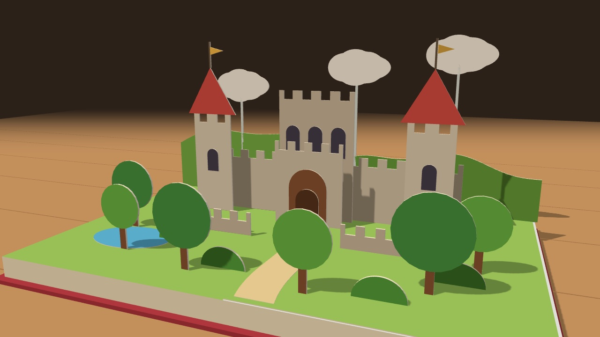

# Tests run against real models

This page records what has been run outside the mock test suite, on what hardware, and with what result. Every number here comes from a single run unless it says otherwise. Single runs are data points, not benchmarks.

## Setup

| | |
| --- | --- |
| Machine | Mac Studio, Apple M5 Max, 128 GB |
| Local server | llama.cpp 0.9.0 (build 12110), Homebrew |
| Worker model | `unsloth/Qwen3.8-27B-GGUF:UD-Q4_K_XL` |
| Server flags | `--jinja -c 196608 -np 3` (three slots of 65,536 tokens) |
| Lead host | Claude Code 2.1.322, headless (`claude -p`), logged in with a claude.ai account |
| Node | 26.13.1 |

Start the server:

```
brew install llama.cpp
llama-server -hf unsloth/Qwen3.8-27B-GGUF:UD-Q4_K_XL --jinja -c 196608 -np 3 --port 8080
```

The first start downloads about 17 GB.

## 1. Mock test suite

`npm test`: 14 of 14 pass.

## 2. `crewlead doctor`

```
ok    builder  qwen3.8-27b @ http://127.0.0.1:8080/v1  2992 ms  tool calling: yes
FAIL  builder-remote  qwen/qwen3.8-27b @ https://openrouter.ai/api/v1  missing API key: set OPENROUTER_API_KEY ...
```

The local worker passes. The OpenRouter worker fails because no key was set on this machine, which is the expected message. **The OpenRouter fallback has not been run against the live API yet.** The model id `qwen/qwen3.8-27b` is listed by OpenRouter's public model list with tool support.

## 3. One task from the CLI

```
crewlead run "Create fizzbuzz.js exporting fizzbuzz(n) ... and fizzbuzz.test.js using node:test ..." --verify "node --test"
```

| Status | Verify | Steps | Prompt tokens | Completion tokens | Time |
| --- | --- | --- | --- | --- | --- |
| done | passed, attempt 1 | 4 | 4,571 | 650 | 26.4 s |

Thinking was on (the model's default).

## 4. Three tasks in parallel

`Pool.delegateBatch` with three independent tasks (an RFC 4180 CSV parser, an LRU cache, a slugify function), each with its own `owns` and `verify`, on the three server slots. Thinking on.

| Task | Status | Verify | Tests | Prompt tokens | Completion tokens | Time |
| --- | --- | --- | --- | --- | --- | --- |
| csv | done | passed, attempt 1 | 11 | 6,977 | 4,290 | 468.2 s |
| lru | done | passed, attempt 1 | 8 | 8,030 | 3,478 | 194.7 s |
| slug | done | passed, attempt 1 | 6 | 5,825 | 1,579 | 92.6 s |

Batch wall time 468.2 s. Most of the completion tokens were reasoning.

Turning thinking off per worker, with no server restart:

```json
"extraBody": { "chat_template_kwargs": { "enable_thinking": false } }
```

The slug task alone with thinking off: done, verify passed on attempt 1, 622 completion tokens, 24.9 s. This is not a clean comparison with the 92.6 s above, which shared the server with two other tasks.

## 5. Claude Code plugin

Loaded with `claude --plugin-dir <repo>` in a headless session. `claude plugin validate .` passes (warnings: no icon).

| Check | Result |
| --- | --- |
| MCP server | `plugin:crewlead:crewlead` connected, tools `delegate`, `delegate_batch`, `list_workers` |
| Skill | `crewlead:crewlead` listed |
| Boss mode hook | With `.crewlead/boss` present, `Write` was denied even though it was on the allowlist. The file was not created. |

**Found and fixed: the lead drafted code before delegating.** With boss mode on, a Haiku lead asked to build a Roman numeral module wrote the whole module into three `Write` calls, got three denials, and only then looked up the crewlead tools (Claude Code defers MCP tools behind tool search). A `UserPromptSubmit` hook now tells the lead, when boss mode is on, to delegate and names the tools.

| Run (Haiku lead, Qwen worker) | Lead `Write` attempts | Lead cost | Time | Tests passing |
| --- | --- | --- | --- | --- |
| Before the fix | 3, all denied | $0.0102 | 85.2 s | 27 |
| After the fix | 0 | $0.0079 | 79.6 s | 30 |

Lead cost is `total_cost_usd` as Claude Code reports it. On a claude.ai login this is the list price equivalent (`costBasis: "list"`), not what the account is billed.

**Setup from inside Claude Code.** In an empty folder, a Haiku lead given only "set up crewlead" loaded the skill, called `setup` with `detect` then `write`, and wrote `crewlead.config.json` with the local server, its 3 slots and thinking off. The worker check passed. 20 to 85 s depending on server load, $0.006 per run. The first version of the skill made the lead write to the user scope (`~/.config/crewlead/`) unasked; the wording now keeps it in the project unless the user asks for all projects.

**MCP only.** `claude mcp add crewlead -- npx -y github:antonellof/crewlead mcp` shows `Connected` in `claude mcp list`.

Not yet tested: installing through `/plugin marketplace add`, and an interactive (non headless) session.

## 6. Pop-up book film: lead alone vs lead plus workers

A replication of a [community run](https://www.reddit.com/r/Qwen_AI/comments/1xs70ch/) that built a 30-second Three.js film of a pop-up book with four worlds. Same prompt for both arms: [`bench/popup-book/prompt.md`](../bench/popup-book/prompt.md). Lead: Fable 5.2 (`claude-fable-5-2`) in headless Claude Code. One run per arm, run on 2026-11-12.

- **Solo:** Fable writes every file itself.
- **Crew:** crewlead plugin loaded, boss mode on, three Qwen 3.8 27B workers on the local server, thinking off ([`bench/crewlead.bench.json`](../bench/crewlead.bench.json)).

Raw results: [`solo`](../bench/popup-book/results/2026-11-12-solo.json), [`crew`](../bench/popup-book/results/2026-11-12-crew.json).

### Result

| | Solo | Crew |
| --- | --- | --- |
| Wall time | **14:28** | 57:31 |
| Lead cost (list price) | $5.27 | **$3.66** (-30%) |
| Lead output tokens | 84,159 | **41,935** (-50%) |
| Files written by the lead | 19 writes | **0** |
| Worker tasks | none | 18: 12 done, 4 max_steps, 2 error |
| Worker tokens (local, free) | none | 71,752 out |
| Lines in the result | 1,363 (127 of them a Node test harness) | 1,627 |
| Console errors at 2, 8, 14, 20, 26 s | none | none |

The lead cost is `total_cost_usd` as Claude Code reports it. On a claude.ai login it is the list price equivalent, not a bill.

**Cheaper, but much slower.** The crew run cut the lead's cost by 30% and its output tokens by half, and the lead never wrote a file. It took four times as long. The community post reported the crew arm as 5x cheaper and 2x faster; this run does not reproduce that. Part of the gap is crewlead bugs found by this run (below). The crew time also includes a few minutes where other tests shared the same llama.cpp server.

### Round by round (crew)

| Round | Tasks | Done | Batch time | What happened |
| --- | --- | --- | --- | --- |
| 1 | core, paper-book, castle, jungle, port, mountains | 1 of 6 | 32:50 | 3 tasks hit 60 steps with no file written, 2 overflowed the 64K context |
| 2 | shell, time-camera, paper, book | 4 of 4 | 3:24 | Narrow briefs, one or two files each, 3 steps each, verify passed first try |
| 3 | castle, jungle, port, mountains | 4 of 4 | 9:23 | 7 to 13 steps each, verify passed first try |
| 4 | fix-castle, fix-jungle, fix-port, fix-mountains | 3 of 4 | about 4:30 | fix-port hit 60 steps |

The same shape as the community run: a rough first round, then a clean one after the lead narrowed the briefs.

### Bugs this run found

1. **Context overflow is fatal.** Two workers grew past the 65,536 token slot (68,069 and 65,617 tokens) and llama.cpp returned `exceed_context_size_error`. Crewlead reported `error` and the work was lost. The worker loop never trims old tool output.
2. **`max_steps` says nothing.** Four tasks used all 60 steps and the result was "(the worker gave no report)" with no files changed. The lead cannot tell a loop from slow progress.
3. **No progress while a batch runs.** Round 1 took 33 minutes and the lead saw only heartbeats. The slowest task holds the whole batch.

### Screenshots

Taken with `bench/screenshot.js` (headless Chrome, 1280x720, `?t=` seek).

| t | Solo (Fable alone) | Crew (Fable + 3 local Qwen) |
| --- | --- | --- |
| 2 s |  |  |
| 8 s |  |  |
| 14 s |  |  |
| 20 s |  |  |
| 26 s |  |  |

Both films show the book, all four worlds and the paper look. The solo film is more detailed (a tiger and a parrot in the jungle, a snowman on the peaks) and keeps the paper-coloured backdrop. The crew film is plainer, uses a dark backdrop, and has a few poles passing through boats and clouds.

## Not tested yet

- OpenRouter as a live fallback (needs `OPENROUTER_API_KEY`).
- Codex and Pi hosts.
- More than three parallel slots.

## Reproduce

```
# terminal 1
llama-server -hf unsloth/Qwen3.8-27B-GGUF:UD-Q4_K_XL --jinja -c 196608 -np 3 --port 8080

# terminal 2
node bench/run.js --arm solo --task popup-book
node bench/run.js --arm crew --task popup-book
node bench/screenshot.js bench/out/<run>/app bench/out/<run>/screens
```

`bench/run.js` uses whatever login the `claude` CLI has. The crew arm reads [`bench/crewlead.bench.json`](../bench/crewlead.bench.json).
