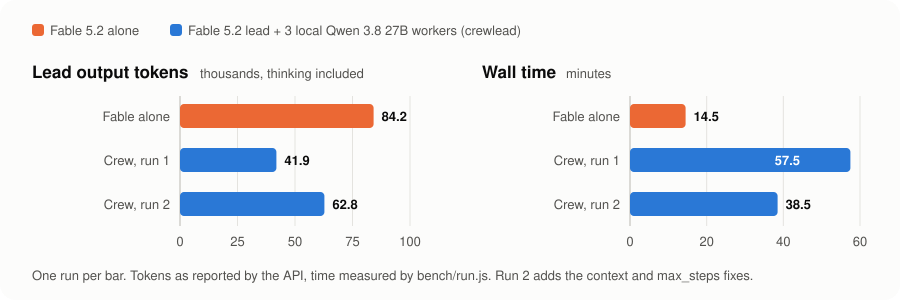
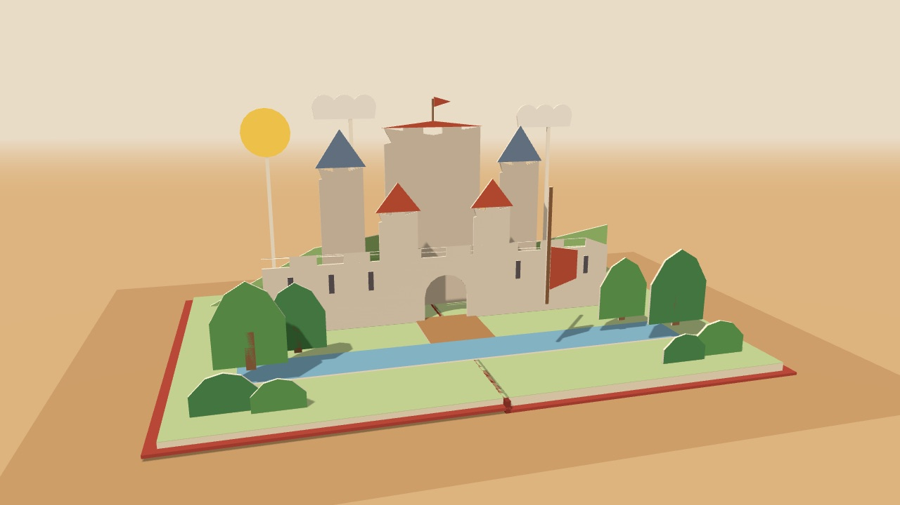
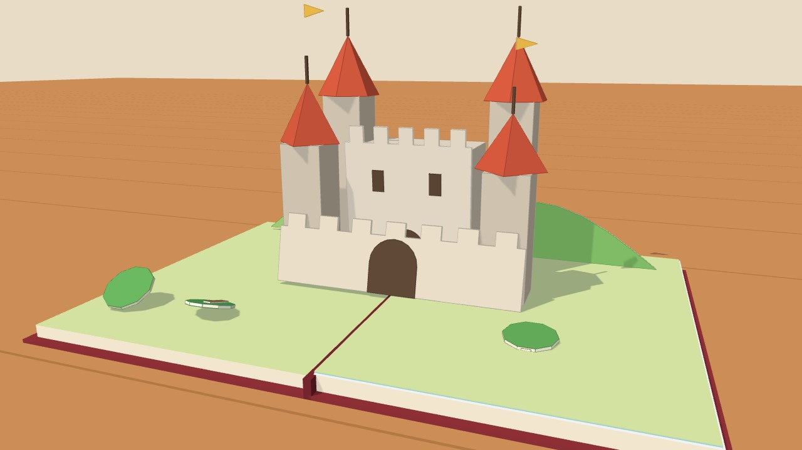
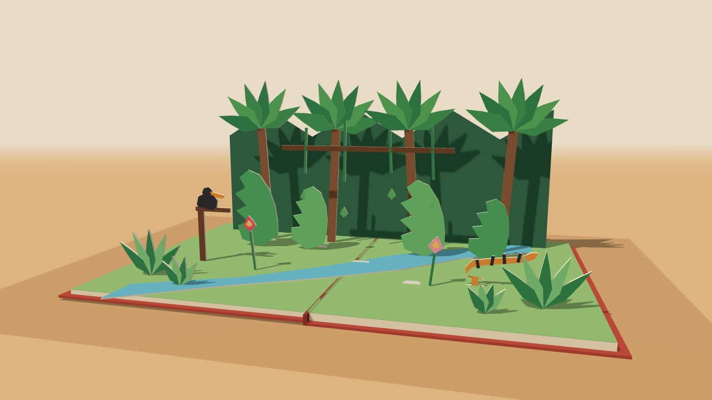
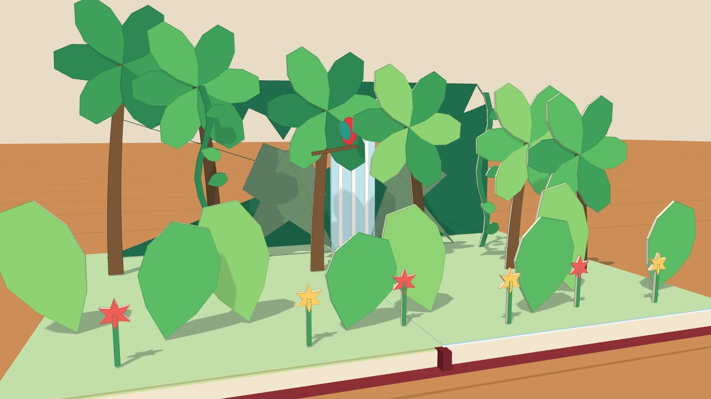
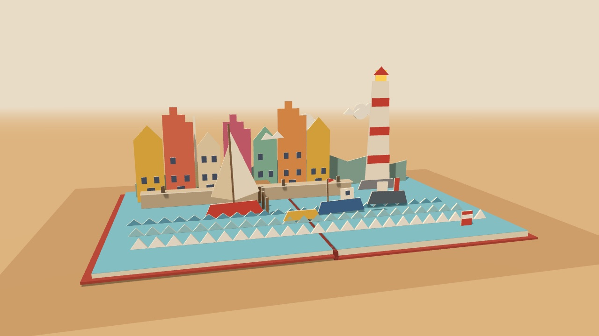
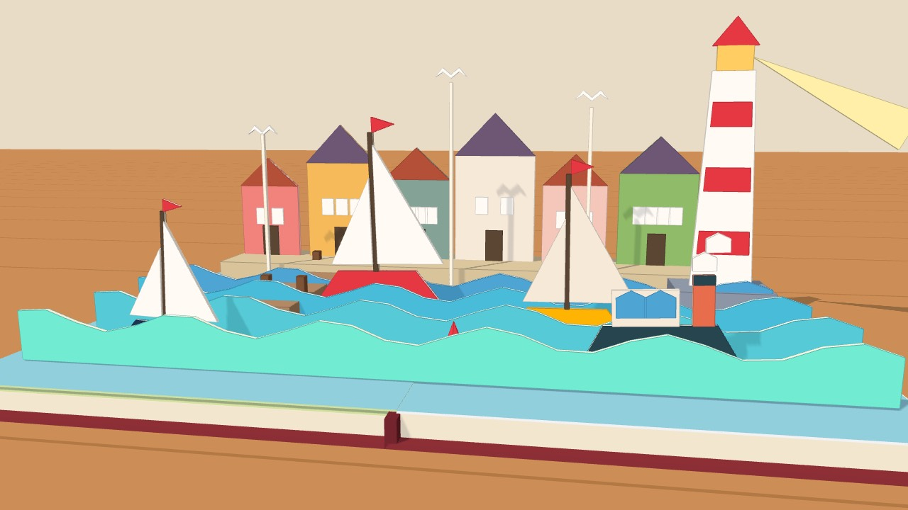

# Tests run against real models

This page records what has been run outside the mock test suite, on what hardware, and with what result. Every number here comes from a single run unless it says otherwise. Single runs are data points, not benchmarks.

## Setup

| | |
| --- | --- |
| Machine | Mac Studio, Apple M5 Max, 128 GB |
| Local server | llama.cpp 0.9.0 (build 12110), Homebrew |
| Worker model | `unsloth/Qwen3.8-27B-GGUF:UD-Q4_K_XL` |
| Server flags | `--jinja -c 196608 -np 3` (three slots of 65,536 tokens) |
| Lead host | Claude Code 2.1.322, headless (`claude -p`), logged in with a claude.ai account |
| Node | 26.13.1 |

Start the server:

```
brew install llama.cpp
llama-server -hf unsloth/Qwen3.8-27B-GGUF:UD-Q4_K_XL --jinja -c 196608 -np 3 --port 8080
```

The first start downloads about 17 GB.

## 1. Mock test suite

`npm test`: 14 of 14 pass.

## 2. `crewlead doctor`

```
ok    builder  qwen3.8-27b @ http://127.0.0.1:8080/v1  2992 ms  tool calling: yes
FAIL  builder-remote  qwen/qwen3.8-27b @ https://openrouter.ai/api/v1  missing API key: set OPENROUTER_API_KEY ...
```

The local worker passes. The OpenRouter worker fails because no key was set on this machine, which is the expected message. **The OpenRouter fallback has not been run against the live API yet.** The model id `qwen/qwen3.8-27b` is listed by OpenRouter's public model list with tool support.

## 3. One task from the CLI

```
crewlead run "Create fizzbuzz.js exporting fizzbuzz(n) ... and fizzbuzz.test.js using node:test ..." --verify "node --test"
```

| Status | Verify | Steps | Prompt tokens | Completion tokens | Time |
| --- | --- | --- | --- | --- | --- |
| done | passed, attempt 1 | 4 | 4,571 | 650 | 26.4 s |

Thinking was on (the model's default).

## 4. Three tasks in parallel

`Pool.delegateBatch` with three independent tasks (an RFC 4180 CSV parser, an LRU cache, a slugify function), each with its own `owns` and `verify`, on the three server slots. Thinking on.

| Task | Status | Verify | Tests | Prompt tokens | Completion tokens | Time |
| --- | --- | --- | --- | --- | --- | --- |
| csv | done | passed, attempt 1 | 11 | 6,977 | 4,290 | 468.2 s |
| lru | done | passed, attempt 1 | 8 | 8,030 | 3,478 | 194.7 s |
| slug | done | passed, attempt 1 | 6 | 5,825 | 1,579 | 92.6 s |

Batch wall time 468.2 s. Most of the completion tokens were reasoning.

Turning thinking off per worker, with no server restart:

```json
"extraBody": { "chat_template_kwargs": { "enable_thinking": false } }
```

The slug task alone with thinking off: done, verify passed on attempt 1, 622 completion tokens, 24.9 s. This is not a clean comparison with the 92.6 s above, which shared the server with two other tasks.

## 5. Claude Code plugin

Loaded with `claude --plugin-dir <repo>` in a headless session. `claude plugin validate .` passes (warnings: no icon).

| Check | Result |
| --- | --- |
| MCP server | `plugin:crewlead:crewlead` connected, tools `delegate`, `delegate_batch`, `list_workers` |
| Skill | `crewlead:crewlead` listed |
| Boss mode hook | With `.crewlead/boss` present, `Write` was denied even though it was on the allowlist. The file was not created. |

**Found and fixed: the lead drafted code before delegating.** With boss mode on, a Haiku lead asked to build a Roman numeral module wrote the whole module into three `Write` calls, got three denials, and only then looked up the crewlead tools (Claude Code defers MCP tools behind tool search). A `UserPromptSubmit` hook now tells the lead, when boss mode is on, to delegate and names the tools.

| Run (Haiku lead, Qwen worker) | Lead `Write` attempts | Lead output tokens | Time | Tests passing |
| --- | --- | --- | --- | --- |
| Before the fix | 3, all denied | 6,182 | 85.2 s | 27 |
| After the fix | 0 | 3,400 | 79.6 s | 30 |

Token counts are the ones the API reports to Claude Code. No dollar figures appear on this page: the runs used a claude.ai login, so nothing was billed per run, and Claude Code's `total_cost_usd` is only an estimate at list prices.

**Setup from inside Claude Code.** In an empty folder, a Haiku lead given only "set up crewlead" loaded the skill, called `setup` with `detect` then `write`, and wrote `crewlead.config.json` with the local server, its 3 slots and thinking off. The worker check passed. 20 to 85 s depending on server load, 950 to 1,350 lead output tokens. The first version of the skill made the lead write to the user scope (`~/.config/crewlead/`) unasked; the wording now keeps it in the project unless the user asks for all projects.

**MCP only.** `claude mcp add crewlead -- npx -y github:antonellof/crewlead mcp` shows `Connected` in `claude mcp list`.

Not yet tested: installing through `/plugin marketplace add`, and an interactive (non headless) session.

## 6. Pop-up book film: lead alone vs lead plus workers

A replication of a [community run](https://www.reddit.com/r/Qwen_AI/comments/1xs70ch/) that built a 30-second Three.js film of a pop-up book with four worlds. Same prompt for every run: [`bench/popup-book/prompt.md`](../bench/popup-book/prompt.md). Lead: Fable 5.2 (`claude-fable-5-2`) in headless Claude Code. Runs 1 to 3 and solo on 2026-11-12, run 4 on 2026-11-13.

- **Solo:** Fable writes every file itself.
- **Crew:** crewlead plugin loaded, boss mode on, three Qwen 3.8 27B workers on the local llama.cpp server, thinking off ([`bench/crewlead.bench.json`](../bench/crewlead.bench.json)).
- **Crew, run 2:** the same, after the context overflow and max_steps fixes. Nothing else used the llama.cpp server during this run.
- **Crew, run 3:** the same, plus the cap on shell commands without a file change.
- **Crew, run 4:** every fix: the `node:http` client without the 300 s limit, and the `run` tool taken away after three refusals. The idle MLX server was stopped first.

Raw results: [`solo`](../bench/popup-book/results/2026-11-12-solo.json), [`crew run 1`](../bench/popup-book/results/2026-11-12-crew.json), [`crew run 2`](../bench/popup-book/results/2026-11-12-crew-2.json), [`crew run 3`](../bench/popup-book/results/2026-11-12-crew-3.json), [`crew run 4`](../bench/popup-book/results/2026-11-13-crew-4.json).



### Result

| | Solo | Crew, run 1 | Crew, run 2 | Crew, run 3 | Crew, run 4 |
| --- | --- | --- | --- | --- | --- |
| Wall time | **14:28** | 57:31 | 38:28 | 76:13 | 22:48 |
| Lead output tokens (thinking included) | 84,159 | 41,935 | 62,771 | 40,225 | **37,019** |
| Lead thinking tokens | 47,129 | 16,694 | **12,871** | 15,421 | 13,259 |
| Lead cached input read | 1,175,700 | 1,416,681 | 1,442,987 | 1,420,816 | **825,549** |
| Files written by the lead | 19 writes | **0** | **0** | **0** | **0** |
| Worker tasks | none | 18: 12 done, 4 max_steps, 2 error | 15: **13 done**, 2 max_steps, 0 error | 16: 12 done, 2 max_steps, 2 error | 11: **11 done** |
| Worker output tokens (local) | none | 71,752 | 55,565 | 78,857 | 36,555 |
| Lines of film code | 1,236 | 1,627 | 2,012 | 2,296 | 1,681 |
| Console errors at 2, 8, 14, 20, 26 s | none | none | none | none | none |

All token counts are as the API reports them; wall time is measured by `bench/run.js`. There are no dollar figures: these runs used a claude.ai login, so nothing was billed per run.

**What the lead saved, and what it cost in time.** With workers, Fable wrote no file and produced 25% to 56% fewer output tokens. Runs 1 to 3 read more cached input than solo, because they lasted longer and went back and forth with the workers; run 4 read 30% less. Every crew run was slower than solo: run 4 took 1.6 times the solo wall time, runs 1 to 3 took 2.7 to 5.3 times. The community post reported the crew arm as both cheaper and 2x faster; these runs do not reproduce the speed. The fixes after run 1 cut the crew time from 57:31 to 38:28 and took the first batch from 1 of 6 done to 6 of 7. Run 1 also shared the server with other tests for a few minutes.

### Round by round (crew)

| Round | Tasks | Done | Batch time | What happened |
| --- | --- | --- | --- | --- |
| 1 | core, paper-book, castle, jungle, port, mountains | 1 of 6 | 32:50 | 3 tasks hit 60 steps with no file written, 2 overflowed the 64K context |
| 2 | shell, time-camera, paper, book | 4 of 4 | 3:24 | Narrow briefs, one or two files each, 3 steps each, verify passed first try |
| 3 | castle, jungle, port, mountains | 4 of 4 | 9:23 | 7 to 13 steps each, verify passed first try |
| 4 | fix-castle, fix-jungle, fix-port, fix-mountains | 3 of 4 | about 4:30 | fix-port hit 60 steps |

The same shape as the community run: a rough first round, then a clean one after the lead narrowed the briefs.

Run 2, after the fixes:

| Round | Tasks | Done | Batch time | What happened |
| --- | --- | --- | --- | --- |
| 1 | paper, book, main, castle, jungle, port, peaks | 6 of 7 | 17:43 | No context errors. port wrote its file, then ran 52 shell commands re-checking it and hit 60 steps |
| 2 | preview-tool | 1 of 1 | 1:30 | A small script the lead used to inspect the scene |
| 3 | camera-fix, castle-fix, jungle-fix, port-fix, peaks-fix | 4 of 5 | 9:07 | castle-fix finished on its 60th step after the 3-turns-left warning; jungle-fix ran 55 commands and hit 60 steps |
| 4 | camera-keys | 1 of 1 | 0:35 | |
| 5 | cleanup | 1 of 1 | 0:07 | |

Run 3, with the shell cap:

| Round | Tasks | Done | Batch time | What happened |
| --- | --- | --- | --- | --- |
| 1 | core, book, timeline-camera, castle, jungle, port, mountains | 4 of 7 | 39:44 | jungle and port: `UND_ERR_HEADERS_TIMEOUT`, see bug 5. core ignored 46 refusals of `run` and wrote nothing |
| 2 | core, timeline-camera, jungle | 2 of 3 | 20:28 | jungle made 26 edits toward a "60+ cards" brief and ran out of steps, not a loop |
| 3 | port | 1 of 1 | 3:55 | |
| 4 | shots | 1 of 1 | 1:56 | A script the lead used to inspect each scene |
| 5 | book-fix, castle-fix, paper-camera-fix | 3 of 3 | 2:06 | |
| 6 | shots2 | 1 of 1 | 1:07 | |

Run 4, with every fix:

| Round | Tasks | Done | Batch time | What happened |
| --- | --- | --- | --- | --- |
| 1 | core, paper-book, castle, jungle, port, mountains | 6 of 6 | 13:23 | 5 to 21 steps each, every verify passed. The first clean first round in four runs |
| 2 | shots | 1 of 1 | 0:41 | A script the lead used to inspect each scene |
| 3 | fix-book, fix-castle, fix-stage-camera | 3 of 3 | 1:23 | 4 steps each |
| 4 | shots2 | 1 of 1 | 0:47 | |

In run 4 no worker overflowed its context, reached the step limit, got a shell command refused, or waited more than 300 s for one reply (the longest llama-server request was 288 s). So the run went cleanly, but it did not put the fixes for bugs 3 to 5 under load. With one run per setup, part of the difference from runs 1 to 3 can be the lead planning differently from run to run.

### Bugs these runs found

1. **Context overflow was fatal** (run 1). Two workers grew past the 65,536 token slot and the work was lost. Fixed: workers drop old tool output and old file bodies and retry, or do it early when `contextTokens` is set. Run 2 had no context errors.
2. **`max_steps` said nothing** (run 1). Fixed: the result lists tool calls, files written, the last call and the last message. In run 2 this is how the next problem showed up.
3. **Workers keep running commands after the work is done** (run 2). port, castle-fix and jungle-fix used 52 to 56 shell commands each. Fixed after run 2 with `maxRunsWithoutChange`; not triggered in run 4.
4. **A refusal is not enough** (run 3). core kept calling `run` through 46 refusals. Fixed after run 3: after three refusals in a row the `run` tool is removed until the worker changes a file.
5. **Long worker turns failed at 300 s** (run 3). Node's `fetch` gives up when a server sends no response headers for 300 s, and a non-streaming completion sends none until it is done. Workers writing large files at about 16 tok/s went past that, and each failure was retried four times as "unreachable", costing up to 20 minutes per task. Fixed after run 3: requests go through `node:http`, only `requestTimeoutMs` applies, and a request that used all of it is not retried. Checked on the real server: two identical 9,000-token requests sent at once; crewlead's client returned all 9,000 tokens after 412 s, plain `fetch` failed after 302 s with `UND_ERR_HEADERS_TIMEOUT`. Not triggered in run 4: no reply took more than 288 s.
6. **No progress while a batch runs.** Still open. The slowest task holds the whole batch and the lead sees only heartbeats.

### Screenshots

Taken with `bench/screenshot.js` (headless Chrome, 1280x720, `?t=` seek).

| t | Solo (Fable alone) | Crew, run 1 | Crew, run 2 | Crew, run 3 | Crew, run 4 |
| --- | --- | --- | --- | --- | --- |
| 2 s |  |  |  |  |  |
| 8 s |  |  |  |  |  |
| 14 s |  |  |  |  |  |
| 20 s |  |  |  |  |  |
| 26 s |  |  |  |  |  |

All five films show the book, all four worlds and the paper look. The solo film is more detailed (a tiger and a parrot in the jungle, a snowman on the peaks) and keeps the paper-coloured backdrop. Crew run 1 is plainer, uses a dark backdrop, and has a few poles passing through boats and clouds. Crew run 2 keeps the paper backdrop and its scenes hold together better, with simpler shapes than the solo film. Crew run 3 frames each world closer and has the most detail of the crew runs (a waterfall and a bird in the jungle, figures in the boats); the lead had a worker write a script to inspect each scene before the last round of fixes. Crew run 4 is close to run 3 in detail (a waterfall and a bird in the jungle, a lighthouse with a beam at the port, falling snow on the peaks) with the shortest code of the crew runs; the lead's own notes list a castle path that does not show and a few stray lines on the jungle backdrop.

## 7. Mac servers: llama.cpp vs MLX

Same machine, Qwen 3.8 27B, thinking off (`chat_template_kwargs.enable_thinking: false`), one server under test at a time.

| | llama.cpp 0.9.0 | mlx-vlm 0.7.12 | mlx-vlm 0.7.12 + MTP drafter |
| --- | --- | --- | --- |
| Weights | unsloth Qwen3.8-27B UD-Q4_K_XL GGUF | Swift 1.5 Qwen3.8-27B, MLX 8-bit | same, plus the 8-bit MTP drafter |
| Flags | `--jinja -c 196608 -np 3` | `--max-num-seqs 3`, `APC_ENABLED=1` | same, `--draft-block-size 4` |
| Resident memory | 41.2 GB (3 x 64K-token cache allocated) | 28.4 GB after the runs | not measured |
| 1 stream, tok/s (2 runs) | 25.9, 26.4 | 15.7, 17.4 | 26.6 (cold), 33.2 |
| 3 streams combined, tok/s (2 runs) | 53.2, 54.4 | 50.1, 50.3 | 36.7, 36.9 |
| Valid tool calls | 10 of 10 | not run | 10 of 10 |
| 3-task crewlead batch | 3 of 3 done, 99.8 s | 3 of 3 done, 94.3 s | not run |

Speeds are end to end from [`bench/speed.js`](../bench/speed.js) (400 generated tokens, prefill included). Raw output: [`bench/results/`](../bench/results/). The batch is the CSV parser, LRU cache and slugify tasks from section 4, each with its own `owns` and `verify`; every verify passed on the first attempt on both servers.

With the drafter, mlx-vlm's log shows 32 to 39 tok/s decode for one request and 12.5 tok/s per request with three in flight, so speculative decoding and continuous batching do not add up in this version. A community post reported about 48 to 50 tok/s for one short prompt and about 80 tok/s for four parallel streams on the same hardware; these runs did not reach either figure.

`setup` labelled the mlx-vlm server `custom` and listed the unloaded drafter as a model. It now recognises mlx-vlm by the `loaded` field and skips unloaded drafters.

## Not tested yet

- OpenRouter as a live fallback (needs `OPENROUTER_API_KEY`).
- Codex and Pi hosts.
- More than three parallel slots.

## Reproduce

```
# terminal 1
llama-server -hf unsloth/Qwen3.8-27B-GGUF:UD-Q4_K_XL --jinja -c 196608 -np 3 --port 8080

# terminal 2
node bench/run.js --arm solo --task popup-book
node bench/run.js --arm crew --task popup-book
node bench/screenshot.js bench/out/<run>/app bench/out/<run>/screens
```

`bench/run.js` uses whatever login the `claude` CLI has. The crew arm reads [`bench/crewlead.bench.json`](../bench/crewlead.bench.json).
